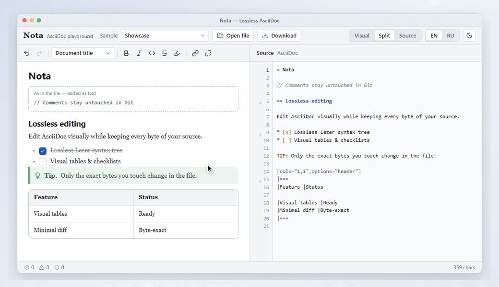

<p align="center"></p>

# Nota

**Lossless AsciiDoc for TypeScript** — a parser that keeps every byte of your source, an HTML converter
compatible with Asciidoctor, and a visual editor on top of them: in the browser and in VS Code.

> Status: **alpha (0.x)**. The API may change between minor versions. Not yet published to npm.

[**Try the demo →**](https://nota-adoc.github.io/nota/) — a single static page: open an `.adoc` file, edit it
visually and as source side by side, download the result. No account, no server; your file never leaves the browser.



## Why

Most AsciiDoc tools convert a document and forget the source. Nota does the opposite: **the text is the truth**.
The syntax tree covers every character, so a visual edit changes only the bytes it has to — the rest of the file,
including spacing, comments and attribute order, stays exactly as you wrote it. That makes a visual editor safe for
files that also live in Git and are edited by hand.

- **Lossless** — `parse(text)` → a tree whose leaves spell the input exactly; there is no printer.
- **Asciidoctor-compatible** — block and inline semantics follow Asciidoctor 2.0; HTML matches its `html5` backend.
  Checked by fuzzing, by block-by-block comparison with Ruby Asciidoctor and Asciidoctor.js, and by the TCK of the
  Eclipse AsciiDoc project.
- **Incremental** — reparsing after an edit equals a full parse, and is fast enough for every keystroke.
- **Minimal edits** — editor operations (typing, marks, lists, tables, moving blocks…) are text changes in the style
  of the document.

## Packages

| Package | What it is |
|---|---|
| `@nota-adoc/core` | Parser, lossless tree ([Lezer](https://lezer.codemirror.net/)), diagnostics, semantic layer (ASG), session with undo history, edit operations |
| `@nota-adoc/html` | HTML converter compatible with Asciidoctor's `html5` backend (embedded document) |
| `@nota-adoc/codemirror` | AsciiDoc for CodeMirror 6: highlighting, folding, diagnostics as lint, completion, a source editor sharing one history |
| `@nota-adoc/prosemirror` | Visual AsciiDoc editor on ProseMirror over the Nota tree |
| `@nota-adoc/react` | Toolbar, selection panel, link field and colour picker for the visual editor (React; English and Russian strings) |

```ts
import { parse } from '@nota-adoc/core'
import { renderHtml } from '@nota-adoc/html'

const doc = parse('= Hello\n\nSome *bold* text.\n')
doc.text === '= Hello\n\nSome *bold* text.\n' // true — nothing is lost
renderHtml(doc) // Asciidoctor-style HTML
```

Each package has its own README with the API: [core](packages/core/README.md), [html](packages/html/README.md),
[codemirror](packages/codemirror/README.md), [prosemirror](packages/prosemirror/README.md),
[react](packages/react/README.md).

How Nota differs from Asciidoctor (what is supported, what is not, where the output differs):
[docs/asciidoctor-differences.md](docs/asciidoctor-differences.md). Runnable examples of the API are in
[examples/](examples/) (`npx tsx examples/render.ts`). If you work with an AI assistant, point it to
[AGENTS.md](AGENTS.md) (also summarised in [llms.txt](llms.txt)).

## VS Code extension

**Nota** opens `.adoc` / `.asciidoc` files in a visual editor tab: headings, marks, links, lists, admonitions,
code blocks, images, tables and Mermaid diagrams are edited on the page; anything the editor does not understand
stays visible as editable source. The VS Code document remains the truth — save, undo, Git and an open text editor
work as usual. One button switches the same tab to the AsciiDoc source. The extension makes no network requests.

Install: download `nota-vscode-0.1.0.vsix` from the [Releases](https://github.com/nota-adoc/nota/releases) page of this repository and run
`code --install-extension nota-vscode-0.1.0.vsix` (or "Extensions: Install from VSIX…" in VS Code). Settings live under `nota.*` (page width, outline view, anchors,
language of the interface). The interface is English by default and Russian when VS Code is Russian
(`nota.language`: `auto`, `ru`, `en`). The README of the extension is in English ([packages/vscode/README.md](packages/vscode/README.md))
and in Russian ([packages/vscode/README.ru.md](packages/vscode/README.ru.md)).

## Development

Node.js 20.19+, 22.13+ or 24:

```sh
npm ci
npm run build       # ESM .js and .d.ts of all packages
npm run typecheck
npm run lint
npx vitest run --project node   # tests by group; the groups and their prerequisites are in CONTRIBUTING.md
npm run demo        # the demo page at http://localhost:5178
npm run vsix        # the VS Code extension package
```

Quality tools (fuzzing, benchmarks, comparison with Asciidoctor, the TCK) live in `quality/`;
see [CONTRIBUTING.md](CONTRIBUTING.md) for the commands and their prerequisites (Docker for Ruby Asciidoctor,
Chrome for the browser tests of the extension).

Issues and pull requests are welcome. Please open an issue before a large change. Every change comes with tests,
and the engine must stay lossless (`npm run fuzz`); the rules are in [CONTRIBUTING.md](CONTRIBUTING.md).

## License

[MIT](LICENSE) © 2026 Kirill Sviridov.
Third-party notices for the bundled editor and extension: [THIRD_PARTY_NOTICES.md](THIRD_PARTY_NOTICES.md).

AsciiDoc® is a trademark of the Eclipse Foundation, Inc. Nota is not affiliated with the Eclipse Foundation or the
Asciidoctor project.
