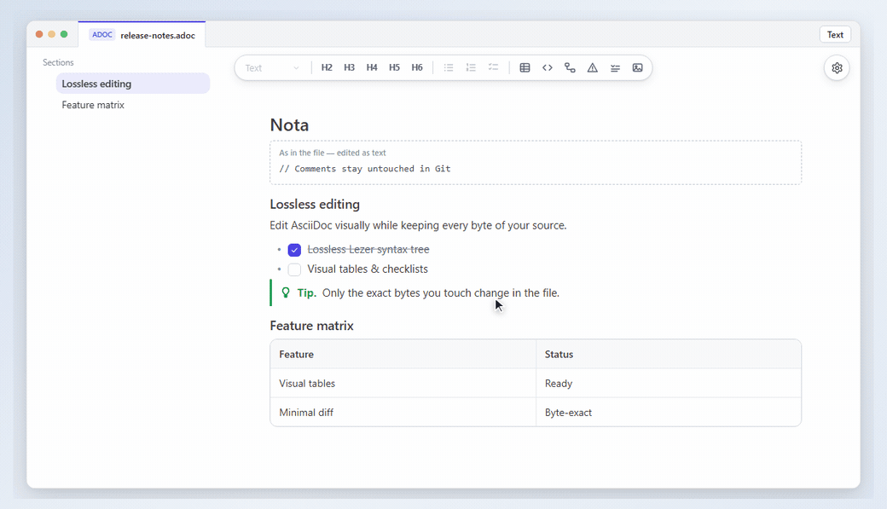

# Nota

**Lossless visual AsciiDoc editor for VS Code.** Edit `.adoc` and `.asciidoc` files visually on the page while keeping the underlying text as the truth — only the bytes you change are touched, so spacing, comments and attributes stay intact in Git.

## Features

- **Visual & Text in one tab** — switch between the visual editor and syntax-highlighted AsciiDoc source with a single button, sharing one cursor position and VS Code undo history.
- **Lossless for Git** — powered by [Nota](https://github.com/nota-adoc/nota)'s Lezer syntax tree; unsupported constructs stay visible as editable source islands instead of being mangled on save.
- **Rich block & inline editing** — headings, marks, text colors/highlights, links (`xref:`, URLs, sections), bulleted/numbered/checklists, admonitions, collapsible blocks, code blocks, local images and live Mermaid diagrams.
- **Visual tables** — edit cells in place, merge/split cells, resize column widths, fill cells and nest tables up to 4 levels.
- **Outline & block handles** — side or floating section outline with drag-to-reorder, plus a block handle (`⋯`) to add captions, anchors or move/delete blocks.
- **Diagnostics** — parser errors and warnings are underlined inline and listed in VS Code's **Problems** panel.
- **Offline & bilingual** — makes zero network requests, supports untrusted/virtual workspaces and speaks English and Russian (`nota.language`).

## Shortcuts

| Action | macOS | Windows / Linux |
|---|---|---|
| Bold / Italic / Monospace | `⌘B` / `⌘I` / `⌘E` | `Ctrl+B` / `Ctrl+I` / `Ctrl+E` |
| Strikethrough / Highlight | `⇧⌘X` / `⇧⌘H` | `Ctrl+Shift+X` / `Ctrl+Shift+H` |
| Paragraph / Heading 2 / Heading 3 | `⌘⌥0` / `⌘⌥2` / `⌘⌥3` | — *(use `/` or toolbar)* |
| Insert block menu | `/` in an empty paragraph | `/` in an empty paragraph |
| Open link / scroll to section | `⌘`-click | `Ctrl`-click |
| Paste formatted / plain text | `⌘V` / `⇧⌘V` | `Ctrl+V` / `Ctrl+Shift+V` |

## Settings

| Setting | Default | Description |
|---|---|---|
| `nota.language` | `auto` | Interface & diagnostics language (`auto`, `en`, `ru`) |
| `nota.pageWidth` | `85` | Page width in `%` of the tab (`50`–`100`) |
| `nota.outlineView` | `capsule` | Section outline mode: `capsule` (hover island) or `side` (pinned sidebar) |
| `nota.showAnchors` | `false` | Show `[[id]]` / `[#id]` anchor lines in Visual mode |
| `nota.blocksInCapsule` | `all` | Toolbar block buttons (`all` or `frequent`) |

## Tips

- **Open `.adoc` as plain text by default:** right-click an `.adoc` tab → *Reopen Editor With…* → *Configure Default Editor for "*.adoc"…* → *Text Editor*.
- **Large files (> 1 MB):** open directly in **Text** mode with a one-click button to switch to Visual mode anyway.

## Links

- [Try the live web demo](https://nota-adoc.github.io/nota/)
- [GitHub repository](https://github.com/nota-adoc/nota)
- [Русская версия (README.ru.md)](https://github.com/nota-adoc/nota/blob/main/packages/vscode/README.ru.md)
- [Full technical specification](https://github.com/nota-adoc/nota/blob/main/docs/vscode-spec.md)
- [Report an issue](https://github.com/nota-adoc/nota/issues)
