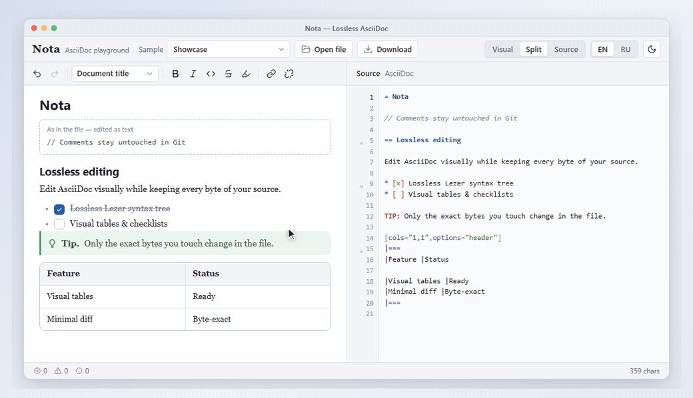

# Nota

[English version](https://github.com/nota-adoc/nota/blob/main/packages/vscode/README.md)

**Визуальный AsciiDoc-редактор для VS Code без потери исходника.** Правьте файлы `.adoc` и `.asciidoc` визуально на странице, пока текст документа остаётся единственной истиной — меняются только затронутые байты, а отступы, комментарии и атрибуты остаются в Git нетронутыми.

## Возможности

- **«Визуально» и «Текст» в одной вкладке** — переключение одной кнопкой между визуальным редактором и исходником с подсветкой синтаксиса, общей позицией курсора и историей отмены VS Code.
- **Без искажений для Git** — работает поверх синтаксического дерева Lezer из [Nota](https://github.com/nota-adoc/nota); неподдерживаемые конструкции остаются редактируемыми островками исходника.
- **Блоки и разметка** — заголовки, выделения, цвет и заливка текста, ссылки (`xref:`, URL, разделы), списки и чеклисты, предупреждения (`NOTE:`, `TIP:`, …), раскрывающиеся блоки, код с подсветкой, локальные картинки и живые схемы Mermaid.
- **Визуальные таблицы** — правка ячеек на месте, объединение/разделение ячеек, перетаскивание ширины колонок, заливка и вложенные таблицы до 4 уровней.
- **Оглавление и ручка блока** — боковая или всплывающая панель разделов с перетаскиванием, а также ручка `⋯` для подписи, якоря и переноса блоков.
- **Диагностики** — ошибки и предупреждения подчёркиваются прямо в тексте и попадают в панель «Проблемы» (Problems).
- **Офлайн и два языка** — никаких сетевых запросов, поддержка `untrustedWorkspaces` / `virtualWorkspaces`, интерфейс на русском и английском (`nota.language`).

## Горячие клавиши

| Действие | macOS | Windows / Linux |
|---|---|---|
| Жирный / Курсив / Моноширинный | `⌘B` / `⌘I` / `⌘E` | `Ctrl+B` / `Ctrl+I` / `Ctrl+E` |
| Зачёркнутый / Выделение цветом | `⇧⌘X` / `⇧⌘H` | `Ctrl+Shift+X` / `Ctrl+Shift+H` |
| Обычный текст / Заголовок 2 / Заголовок 3 | `⌘⌥0` / `⌘⌥2` / `⌘⌥3` | — *(через `/` или панель)* |
| Меню вставки блока | `/` в пустом абзаце | `/` в пустом абзаце |
| Перейти по ссылке / к разделу | `⌘` + щелчок | `Ctrl` + щелчок |
| Вставить с разметкой / как текст | `⌘V` / `⇧⌘V` | `Ctrl+V` / `Ctrl+Shift+V` |

## Настройки

| Настройка | По умолчанию | Описание |
|---|---|---|
| `nota.language` | `auto` | Язык интерфейса и замечаний (`auto`, `en`, `ru`) |
| `nota.pageWidth` | `85` | Ширина страницы в `%` от вкладки (`50`–`100`) |
| `nota.outlineView` | `capsule` | Оглавление: `capsule` (островок при наведении) или `side` (колонка слева) |
| `nota.showAnchors` | `false` | Показывать строки якорей `[[id]]` / `[#id]` в режиме «Визуально» |
| `nota.blocksInCapsule` | `all` | Кнопки блоков в капсуле (`all` — все, `frequent` — частые) |

## Подсказки

- **Открывать `.adoc` текстом по умолчанию:** правый щелчок по вкладке `.adoc` → *Открыть с помощью…* → *Настроить редактор по умолчанию для "*.adoc"…* → *Текстовый редактор*.
- **Файлы больше 1 МБ:** открываются сразу в режиме «Текст» с кнопкой принудительного перехода в «Визуально».

## Ссылки

- [Онлайн-демо в браузере](https://nota-adoc.github.io/nota/)
- [Репозиторий на GitHub](https://github.com/nota-adoc/nota)
- [Полная техническая спецификация (англ.)](https://github.com/nota-adoc/nota/blob/main/docs/vscode-spec.md)
- [Сообщить об ошибке](https://github.com/nota-adoc/nota/issues)
