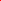

= Картинки

Подпись — строка `.Заголовок` над картинкой.

.Квадрат из папки рядом с файлом

.Пиксель

Картинка без подписи стоит выше этого абзаца.

.Картинки из сети не показываются
image::https://example.com/logo.png[]

.Файла нет на диске
image::img/missing.png[]

Строчная картинка  остаётся частью строки.
